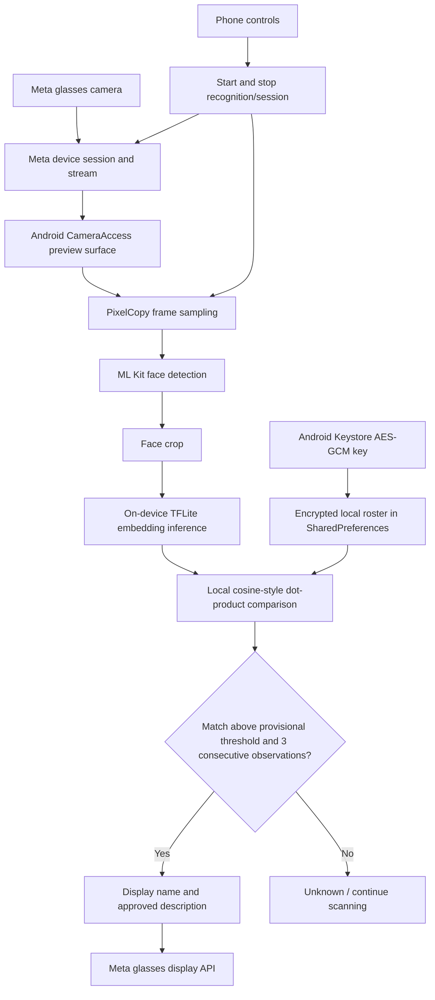

# Architecture and Data Flow — CameraAccess (Checkpoint 3)

**Status:** Source-inspected implementation description; hardware behavior and timing must be validated in the live demo.

## Implemented stack

| Layer | Technology | Source |
|---|---|---|
| Android UI | Kotlin, Jetpack Compose | `app/CameraAccess/app/src/main/java/.../ui/` |
| Wearable connection, camera, display | Meta Wearables Device Access Toolkit | `camera/`, `wearables/`, `stream/`, `ui/DisplayHelper.kt` |
| Face detection | Google ML Kit Face Detection 16.1.7 | `ui/FaceDetectorHelper.kt` |
| Face embedding inference | TensorFlow Lite 2.14.0, bundled `face_model.tflite` | `ui/FaceEmbedder.kt` |
| Face matching | Local embedding similarity against enrolled roster | `ui/RosterStore.kt` |
| Roster persistence | Android SharedPreferences plus Android Keystore AES-GCM encryption | `ui/RosterStore.kt`, `ui/RosterCrypto.kt` |
| Recognition/session control | Kotlin state and timed lifecycle | `ui/LiveRecognizer.kt`, `ui/RecognitionControl.kt` |
| Lens output | Meta display API | `ui/DisplayHelper.kt` |

All paths in the table are relative to `checkpoint3/app/CameraAccess/`.

## Implemented data flow

**Enrollment path:** A consenting participant is enrolled through the app's roster/enrollment UI. A captured face is embedded locally and saved with a name and description through `RosterStore.enroll()`. The code stores embeddings, not a separate relational profile table. The app source does not establish a Google Form/Sheets synchronization path.

**Recognition path:** `LiveRecognizer` samples a frame using `PixelCopy`, asks ML Kit for face bounding boxes, selects the largest detected face, crops it, computes a normalized TFLite embedding, and compares it with enrolled embeddings. `RosterStore.match()` returns the best match only if the similarity score meets the threshold. Three consecutive matches are required before `DisplayHelper.show()` sends the name/description to the glasses.

**Timeouts:** `RecognitionControl.NO_MATCH_TIMEOUT_MS = 30_000` and `SHOW_NAME_MS = 8_000`. `LiveRecognizer` waits approximately 500 ms between processing attempts; this is a loop delay, **not** measured inference latency.

**Display path:** `DisplayHelper.attach()` connects a display to the started session, `show()` sends text content, `clear()` sends a waiting message, and `detach()` releases the display. It suppresses repeated identical display updates for up to 15 seconds.

## Trust boundaries and storage

1. **External physical scene → camera frames:** Frames may contain bystanders. Avoid retaining or exporting frames without consent.
2. **Camera → on-device inference:** ML Kit and the bundled TFLite model process frames locally in this source. There is no implemented external face-recognition API call.
3. **Enrollment UI → local roster:** Names, descriptions and face embeddings are sensitive identifying data. `RosterStore` serializes them to SharedPreferences; `RosterCrypto` encrypts them with AES-GCM using an Android Keystore key.
4. **Local roster → display:** A matched name and description are sent to the glasses display. Only approved, non-sensitive descriptions should be enrolled.
5. **Deletion:** `RosterStore.delete(context, name)` removes a named entry, and `clear(context)` removes all entries from the roster. No server-side copies exist in the inspected app, but external backups or exported data would require separate deletion procedures. Android backup is disabled in the manifest.

## What is *not* implemented in the inspected CameraAccess source

- No separate FastAPI/Node backend, SQL database, remote vector store or API-based student enrollment.
- No verified consent-record schema or explicit persisted consent flag. **Operational consent must be obtained before enrolling a person**; do not claim an enforced consent gate.
- No verified LLM inference, token-metering pipeline, or flashcard generation endpoint in this Android source.
- No verified voice-command launch/stop workflow; `VoiceTrigger.kt` alone is not proof of device invocation.
- No enforced 1–1.5 m distance check; practical recognition distance depends on lighting, resolution and device conditions.
- No validated accuracy/false-match benchmark for the provisional `0.60` threshold.

If other team modules implement flashcards or LLM inference, add them to the architecture only after their code is integrated and their real model calls are verified.

## Design rationale

- **On-device matching** avoids a mandatory network round-trip for face recognition.
- **Encrypted local roster** reduces exposure compared with a public student database, but does not replace consent or retention policies.
- **Three-match confirmation** reduces immediate single-frame false positives, but does not guarantee identity accuracy.
- **Phone-driven sessions** provide an available control path while voice integration is unresolved.

## Demo walkthrough

1. Start the Android app and connect compatible glasses.
2. Enroll a consented test student using the roster UI.
3. Start session and preview on the phone.
4. Start recognition and observe the matched name on the lens.
5. Show an unknown participant and verify no enrolled name appears.
6. Delete the test student and verify the stored roster is updated.
7. End recognition and the device session from the phone.

Hardware behavior, integration with any separate flashcard/LLM feature, and real-device latency remain **to be verified**.
